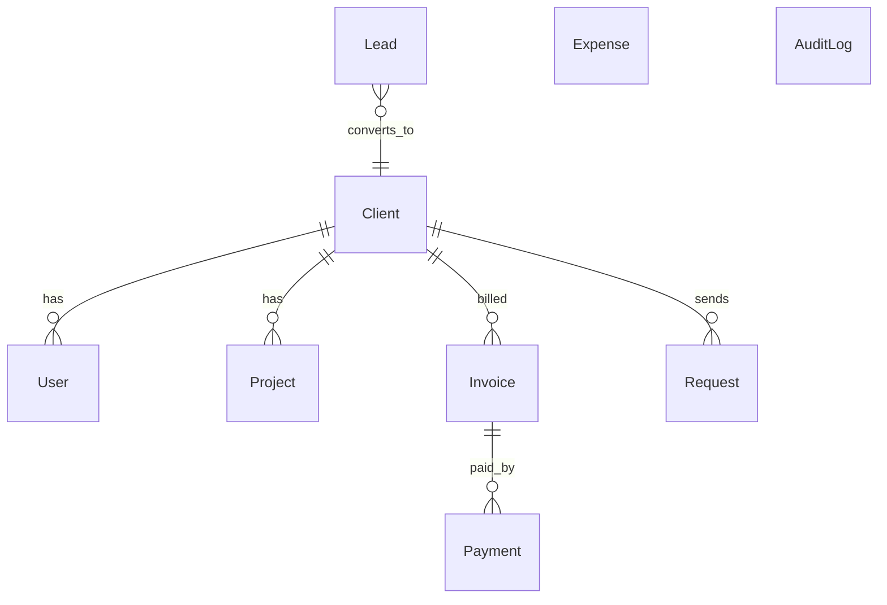

# Mikasa Nexus: architecture, status and plan

Mikasa Nexus is the internal name for one connected platform that runs Mikasa Labs. It is a **modular monolith**: one Next.js app, one PostgreSQL database, one login system, with clearly separated modules. No microservices until scale demands them.

## 1. Status (development log)

| Module | Status |
|---|---|
| Public website with enquiry form | Built. Enquiries are saved as CRM leads. |
| Login, roles (ADMIN, STAFF, CLIENT), invite flow | Built |
| Client portal (admin controls what each client sees) | Built |
| CRM: leads, 7-stage pipeline, convert lead to client | Built |
| Projects and per-client visibility | Built (milestones and tasks not yet) |
| Invoices and M-Pesa payment | Built, sandbox only until Daraja production approval |
| Finance: expenses, cash received vs invoiced vs net | Built (management view, not statutory accounting) |
| CEO dashboard | Built, real data only |
| Audit log | Built for key actions |
| Proposals, contracts, tasks, Academy, HR, Forge, products, automation, AI | Planned |

Not tested by an automated suite yet. Nothing here is claimed as live until it has been run against real data.

## 2. Release plan
1. **Release 1 (this one):** website, auth, CEO dashboard, CRM, clients, projects, basic finance, audit.
2. **Release 2:** proposals (PDF), tasks and milestones, client approvals, file uploads (S3-compatible), support tickets, Academy (students, courses, enrolment, M-Pesa fees).
3. **Release 3:** HR, Mikasa Forge (ideas to prototypes to products), product catalogue, automation engine.
4. **Release 4:** Mikasa Intelligence (AI assistant over real records), knowledge base, developer portal, marketplace.

## 3. Roles and permissions
Enforced on the server in every page and action (never only by hiding buttons).

| Role | Implemented now | Can access |
|---|---|---|
| ADMIN (founder) | yes | Everything |
| STAFF | yes | Clients and projects only. No finance, leads, invoices or audit log |
| CLIENT | yes | Only their own visible projects, invoices, requests |
| Instructor, Student, Finance, HR, Support, Partner, Developer | planned | Added as roles with per-module permissions in Release 2 or 3 |

## 4. Core data model

Planned entities: Proposal, Contract, Milestone, Task, Document, Course, Module, Lesson, Enrolment, Submission, Ticket, Product, ProductVersion, Subscription, Idea, Experiment, Employee, Department, Notification, Workflow.

## 5. Key journeys
- **Enquiry to client:** website form → Lead (NEW) → pipeline → Convert → client invite email → client sets password → sees what you made visible.
- **Invoice to cash:** create invoice (hidden) → show to client (emails them) → client pays via M-Pesa → verified callback → PAID with date → counted in Received.

## 6. External services you will need
PostgreSQL (Neon or Supabase), hosting (Vercel), email (SMTP or a provider), Safaricom Daraja production shortcode, S3-compatible storage (Release 2), error monitoring, WhatsApp Business Platform (optional, official API only), an AI provider (Release 4; kept interchangeable).

## 7. Decisions that need your confirmation
- **Phone number:** the site uses 0780806668 (company profile and brand mockup). The master prompt lists +254 757 807872. Change it in one place: `lib/site.ts`.
- **Privacy:** the enquiry form stores consent. Have the privacy notice and retention rules checked against the Data Protection Act, 2019, and confirm whether Mikasa Labs must register with the Office of the Data Protection Commissioner.
- **Academy wording:** no accredited qualification is claimed anywhere.
- **Pricing, fees and class dates:** not invented. Supply them to publish.
- **Hosting costs and a production Daraja account** before taking real payments.
